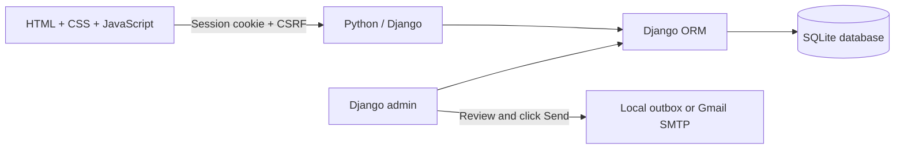
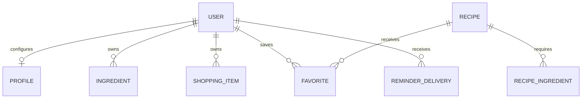

# Fridgewise

A complete local university lab project: a Python/Django backend, HTML/CSS/JavaScript frontend, and persistent SQLite database. Track what is in your fridge, discover recipes, and receive expiry reminders. No paid APIs, Node build, Rust compiler, cloud service, or external image downloads are needed to run the app.

## Run it on Windows

Open PowerShell in this project directory:

```powershell
.\setup.ps1
.\start.ps1
```

Setup installs dependencies in `.venv`, applies database migrations, and seeds 12 recipes and a demo kitchen. **Save the generated admin password printed on first setup.** Re-running setup preserves existing records and passwords. `start.ps1` starts Django; email reminders are manual and no background worker starts. Open **http://127.0.0.1:8000/**. Stop the app with Ctrl+C. If a port is busy, use `.\start.ps1 -Port 8001`.

If your PowerShell policy blocks local scripts, you can use the manual Python commands below instead. Python 3.10 or later is required. The setup script also recognizes the bundled Python on this machine. Supply a particular interpreter using `.\setup.ps1 -Python 'C:\path\to\python.exe'`.

| Account | Username | Password |
| --- | --- | --- |
| Demo home cook | `demo` | `FreshStart!2026` |
| Full administrator | `admin` | Randomly generated and printed by first setup |

Administrator access is at **http://127.0.0.1:8000/admin/**. An administrator's home dashboard shows their own fridge; the administration area grants access to all users, ingredients, recipes, preferences, shopping lists, favorites, and reminder deliveries.

The admin dashboard includes **Browse users’ fridges** and **+ Add a recipe** shortcuts. You can open any user's inventory, edit its ingredients, and create recipes using ingredient rows and cooking steps written one per line. See [the administrator guide](docs/ADMIN.md). Restart an already-running server after applying backend changes.

Forgot the local admin password?

```powershell
.\.venv\Scripts\python.exe manage.py changepassword admin
```

## Manual setup (Windows, macOS, Linux)

```text
python -m venv .venv
```

Use `.venv\Scripts\python.exe` on Windows, or `.venv/bin/python` on macOS/Linux, in place of `python` below. Activating the virtual environment is optional.

```text
python -m pip install -r requirements.txt
python manage.py migrate
python manage.py seed_demo
python manage.py runserver 127.0.0.1:8000
```

For email reminders, use **Admin → Browse users’ fridges → View fridge → Email expiry reminder**. The default backend saves local previews. For actual Gmail delivery, use `start-gmail.ps1`; see [the Gmail email guide](docs/EMAIL.md).

## What works

- Sign up, sign in, sign out, password validation, hashed passwords, sessions, and basic login throttling.
- A personal fridge with ingredient creation, editing, removal, quantities, categories, and expiry dates. Separate batches can have separate expiry dates.
- Search, category filters, expiry/name/category sorting, and CSV export.
- Recipe suggestions based on the user's non-expired ingredients, with common aliases such as tomatoes → tomato and eggs → egg.
- Ready-to-cook, use-soon, vegetarian, vegan, and quick-meal filters; ingredient and title search; recipe details and cooking steps.
- Favorite recipes saved per account.
- A personal shopping list with checkboxes, deduplication, and missing ingredients added directly from a recipe.
- In-app reminders and a configurable 1–14 day warning window. Badges refresh every minute while the page is visible.
- Manual, opt-in expiry emails with recipient/message review, a Send button, delivery history, and a one-email-per-user-per-day limit. Local previews are tracked separately; failed attempts can be retried.
- Django administration for users, permissions, recipes with ingredient rows, and all application records.
- Responsive layouts, keyboard navigation, accessible labels, modal dialogs, inline validation, and original local SVG artwork.

## Explain the architecture



Django serves the login and dashboard HTML. The JavaScript frontend calls authenticated JSON routes under `/api/`. Every user-owned query is scoped to `request.user`; submitted owner IDs are never trusted. A Django superuser manages the platform through `/admin/`. This separation makes it straightforward to replace the frontend later with Rust/Yew or another client using the same API.

**Why this stack:** Django provides authentication, admin, ORM, migrations, validation, and CSRF protection together. SQLite stores the whole local database in one file and needs no separate installation. Plain JavaScript keeps the frontend understandable and avoids a build toolchain. The choice was approved for this project in place of Rust. Django 5.2 is a supported LTS series; see the [official release page](https://www.djangoproject.com/download/).

## Database model



| Table/model | Purpose |
| --- | --- |
| Django `User` | Username, hashed password, email, staff and superuser permissions |
| `Profile` | Reminder window and email preference |
| `Ingredient` | Owner, name, category, decimal quantity, unit, expiry date |
| `Recipe` | Title, description, category, duration, servings, SVG art, JSON cooking steps |
| `RecipeIngredient` | Named ingredient and human-readable amount required by a recipe |
| `Favorite` | Unique user/recipe pair |
| `ShoppingItem` | Unique owner/normalized name pair with checked state |
| `ReminderDelivery` | User/date/channel receipt, recipient, requesting admin, and timestamp |
| `LoginAttempt` | Short-lived failure counter for each hashed IP/username pair |

Database migrations live in `kitchen/migrations/`. Positive ingredient quantities, unique recipe ingredients, unique favorites, unique shopping entries, and one reminder per user/date/channel are enforced by database constraints. Django also creates tables for sessions, permissions, admin logs, and migrations.

## Recipe matching

1. Read only the current user's ingredients.
2. Exclude items with expiry dates before today (Europe/Bucharest).
3. Normalize case, spaces, and known aliases.
4. Compare each recipe's required names with the available ingredient names.
5. Calculate `match = matched names / required names × 100`.
6. Sort by ready-to-cook status, match percentage, number of use-soon ingredients, then shorter cooking time.

Matching checks **ingredient presence**, not sufficient quantity or unit conversion. A recipe may show all ingredient names as present even when there is not enough of one ingredient; the detail dialog displays the required amounts. Salt, pepper, oil, and water are assumed pantry basics. Recipes are curated database entries, not AI-generated suggestions. Allergies, dietary certifications, food condition, and substitutions are not inferred. Expired ingredients remain visible for removal but never count toward a recipe match.

## Manual expiry emails

In-app alerts work without email. The user chooses the warning window and enables **Allow expiry reminder emails** in Settings. Sign in as an administrator, browse to their fridge, click **Email expiry reminder**, review the recipient and message, and press **Save email preview** (local mode) or **Send expiry reminder** (SMTP mode). Only that user's due ingredients are included. A fresh preview is required if the fridge, recipient, or sender settings change.

Local previews are written to the ignored `outbox/` folder. They have a separate daily limit and do not prevent a real Gmail email on the same date. Receipts distinguish local previews from email and record who initiated each one. Opening a fridge or preview never sends mail.

To use Gmail, stop the current server and run:

```powershell
.\start-gmail.ps1
```

Enter your sender Gmail address and a Google App Password at the terminal prompts. The password is hidden and held in process environment variables for this run; it is not saved in the code, database, a settings file, or command-line arguments. Read [the Gmail setup guide](docs/EMAIL.md) for Google's prerequisites and testing steps. Actual Gmail delivery cannot be verified until you supply your credentials locally and press Send to an opted-in account with a real address.

There is no reminder watcher or scheduled email task. The old `--watch` option has been removed. A one-off bulk command, `python manage.py send_expiry_reminders`, remains available for explicitly requested manual administration; it processes eligible users once and exits. Stop any previously running version before restarting so an old worker does not continue.

## Automated verification

```powershell
.\.venv\Scripts\python.exe manage.py test
.\.venv\Scripts\python.exe manage.py check
.\.venv\Scripts\python.exe manage.py makemigrations --check --dry-run
node --check .\static\app.js
```

Node is optional and is only used for the last syntax check. The Django tests use an isolated temporary test database. They cover account creation, login throttling, ownership, CSRF, CRUD and validation, matching and expiry boundaries, favorites, shopping lists, CSV safety, admin permissions, reminder opt-in/deduplication/retry, and repeatable demo seeding.

## Project layout

```text
fridgewise/                  Django configuration and root routes
kitchen/models.py            Persistent data and database constraints
kitchen/forms.py             Server-side validation
kitchen/views.py             Account pages and JSON API handlers
kitchen/services.py          Recipe matching and expiry logic
kitchen/admin.py             Administration panels
kitchen/seed_data.py          Original curated demo recipes
kitchen/reminders.py         Email composition, validation, delivery, and duplicate prevention
kitchen/management/commands/ Seed and one-off reminder commands
kitchen/migrations/          Versioned database schema
kitchen/tests.py             Functional and security tests
templates/                   Login, signup, dashboard, icons
static/                      Styles, JavaScript, and local artwork
tools/generate_art.py        Reproducible SVG artwork generator
docs/DEMO.md                 Professor demonstration walkthrough
docs/API.md                  Endpoint reference
setup.ps1 / start.ps1        Windows setup and application startup
start-gmail.ps1              Gmail startup with hidden App Password prompt
db.sqlite3                   Local runtime database (ignored by Git)
```

## Sharing and deployment

This project is intended for a local lab demonstration and has not been published to the internet. Sites hosting runs JavaScript Workers and does not run this Python backend, so the local app preserves the Python requirement. Share the source and `requirements.txt`; the recipient should create their own virtual environment and run migrations. A virtual environment is not portable between computers. Generate a portable submission with `python tools/package_source.py`. This writes `artifacts/Fridgewise-source.zip`, including the source and documentation while excluding `.venv`, `.secret_key`, `db.sqlite3`, `outbox`, and generated test artifacts.

For a public deployment, use Python-capable hosting, a production WSGI server, HTTPS, `DJANGO_DEBUG=0`, a strong `DJANGO_SECRET_KEY`, explicit `DJANGO_ALLOWED_HOSTS`, and static file serving after `collectstatic`. Emails remain manual. Remove the known demo account and set real admin credentials. SQLite is suitable for this local lab; move to PostgreSQL for multiple workers or higher write traffic. The production flags in settings are a starting point, not a claim that the development server is production hosting. Standard account recovery/email verification, distributed rate limiting, production monitoring, and backups would be additional deployment work.
